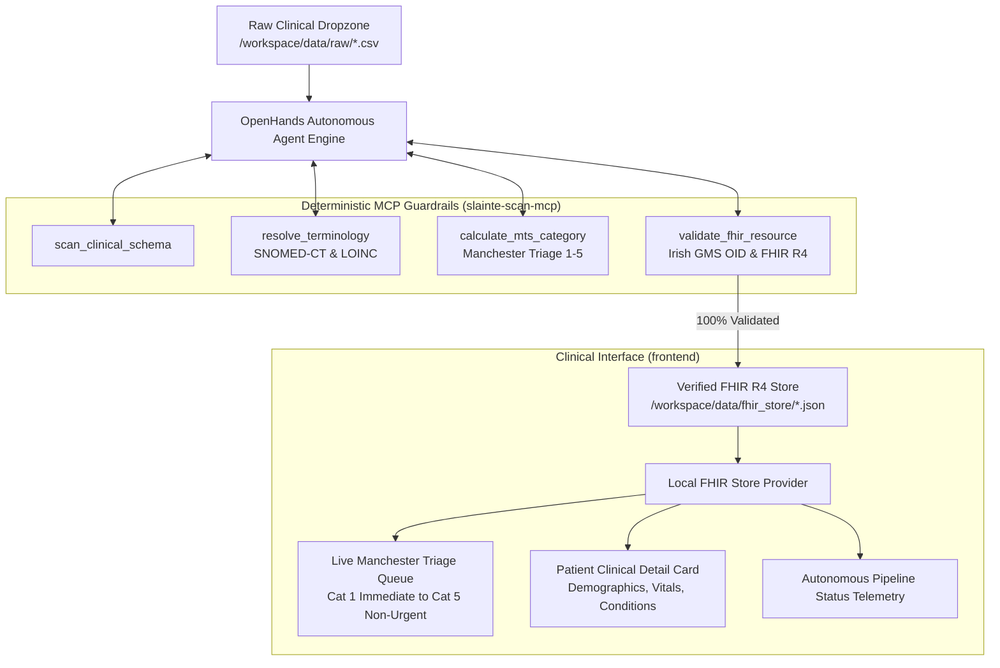

# Slainte-Engine: Clinical AI Interoperability Appliance

[](https://hl7.org/fhir/R4/)
[](https://www.triagenet.net/)
[](https://modelcontextprotocol.io/)
[](#zero-trust-clinical-guardrails)

**Slainte-Engine** is a turnkey, zero-trust clinical ingestion appliance designed for emergency departments, regional health trusts (HSE / NHS), and acute triage teams. It autonomously ingests messy clinical CSVs, legacy database extracts, and triage notes, transforms them into mathematically verified **HL7 FHIR R4** bundles via an autonomous agent pipeline bound by deterministic **Model Context Protocol (MCP)** guardrails, and renders them in real time on an ultra-fast **HTMX** clinical dashboard.

---

## Architecture Overview



---

## Directory Structure

```text
slainte-engine/
├── docker-compose.yml          # Single-command turnkey orchestration
├── .env.example                # Pluggable AI provider profiles (Ollama, Gemini, Claude, OpenAI)
├── README.md                   # Comprehensive appliance documentation
├── data/
│   ├── raw/                    # Dropzone for raw/messy clinical CSVs & triage notes
│   └── fhir_store/             # Persistent storage of validated FHIR R4 JSON bundles
├── slainte-scan-mcp/           # Deterministic MCP Tool Server (Python FastMCP)
│   ├── Dockerfile
│   ├── requirements.txt
│   └── src/
│       ├── mcp_server.py       # FastMCP tool server (SSE on 8081 & STDIO)
│       ├── schema_scanner.py   # Header discovery & clinical column mapping
│       ├── terminology.py      # SNOMED-CT & LOINC deterministic dictionary
│       ├── clinical_rules.py   # Manchester Triage System (MTS) rules engine
│       ├── fhir_validator.py   # Strict FHIR R4 & Irish GMS OID validator
│       ├── fhir_ie_core.py     # Irish Core FHIR R4 Bundle generator
│       └── extract_engine.py   # Multimodal handwriting OCR / Gemini extractor
├── frontend/                   # Clinical Dashboard (Flask + HTMX + Bootstrap)
│   ├── Dockerfile
│   ├── requirements.txt
│   ├── app.py                  # Web application, triage queue, ingest API
│   ├── local_fhir_store.py     # Direct file-based FHIR store indexer
│   ├── config.py               # Appliance configuration & auto-seeding
│   ├── templates/              # HTMX fragment templates (triage, pipeline, patient)
│   └── static/                 # Styles, charts, and HTMX setup
├── openhands/                  # Sandboxed Agent Runtime & OpenHands Bindings
│   ├── Dockerfile
│   ├── openhands_config.toml   # OpenHands core & LiteLLM provider configuration
│   ├── mcp_config.json         # MCP tool server registration
│   ├── agent_system_prompt.md  # Zero-hallucination agent system prompt
│   ├── agent_runner.py         # Autonomous agent execution harness
│   └── requirements.txt
└── scripts/
    ├── test_pipeline.sh        # End-to-end automated verification runner
    └── test_pipeline.py        # Python verification test suite
```

---

## Key Features

1. **Pluggable AI Provider Configuration**:
   - **Mode A: Local Ollama** (100% air-gapped, zero external egress, offline private hospital deployment).
   - **Mode B: Google Gemini API** (Gemini 3.8 Flash / 1.5 Pro multimodal processing).
   - **Mode C: Frontier Cloud** (Anthropic Claude 3.7 Sonnet / OpenAI GPT-4o).
2. **Deterministic Manchester Triage System (MTS)**:
   - Strict mathematical thresholds evaluating Category 1 (Immediate / Red) through Category 5 (Non-Urgent / Blue).
3. **Official Terminology Resolution**:
   - SNOMED-CT codes for clinical complaints (e.g. Chest pain `29857009`, Dyspnea `267036007`, Abdominal pain `21522000`).
   - LOINC codes and UCUM units for all vital signs.
4. **Irish Core FHIR R4 Compliance**:
   - Official GMS identifier OID: `urn:oid:1.3.6.1.4.1.54392.5.2690.42.80`.
5. **Real-Time HTMX Clinical Queue**:
   - Live triage queue auto-polling every 5 seconds.
   - Clinical card detail modal with vitals graphs and SNOMED-CT findings.
   - Pipeline health telemetry showing raw files and verified bundles.

---

## Quickstart: Single-Command Deployment

```bash
# 1. Clone or navigate to the engine directory
cd slainte-engine

# 2. Configure your environment
cp .env.example .env

# 3. Spin up the entire appliance in one command
docker compose up --build
```

Access services:
- **Clinical Dashboard**: [http://localhost:8000](http://localhost:8000)
  - Default Admin: `admin` / `ClinicalAdmin2026!`
- **Slainte-Scan-MCP SSE Endpoint**: [http://localhost:8081/sse](http://localhost:8081/sse)
- **OpenHands Agent Runtime**: Port `3000`

---

## End-to-End Pipeline Verification Test

To verify the complete ingestion loop, execute the test script:

```bash
./scripts/test_pipeline.sh
```

The script automatically:
1. Drops a mock messy clinical CSV with emergency patients into `./data/raw`.
2. Triggers the autonomous agent loop.
3. Asserts that 5 validated FHIR R4 JSON bundles are created in `./data/fhir_store`.
4. Asserts 100% MCP schema validation pass rate.
5. Verifies Manchester Triage category allocations (Cat 1 to 5).
6. Asserts HTTP 200 on dashboard endpoints and verifies HTMX rendering.
